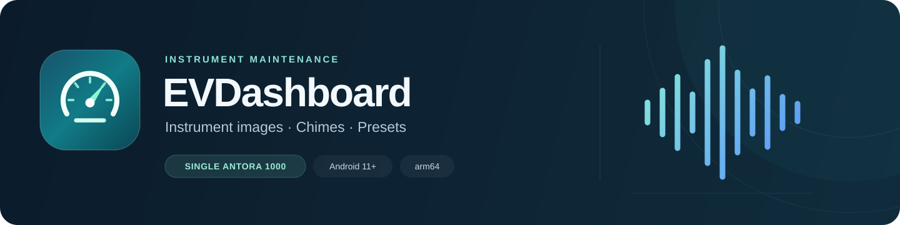
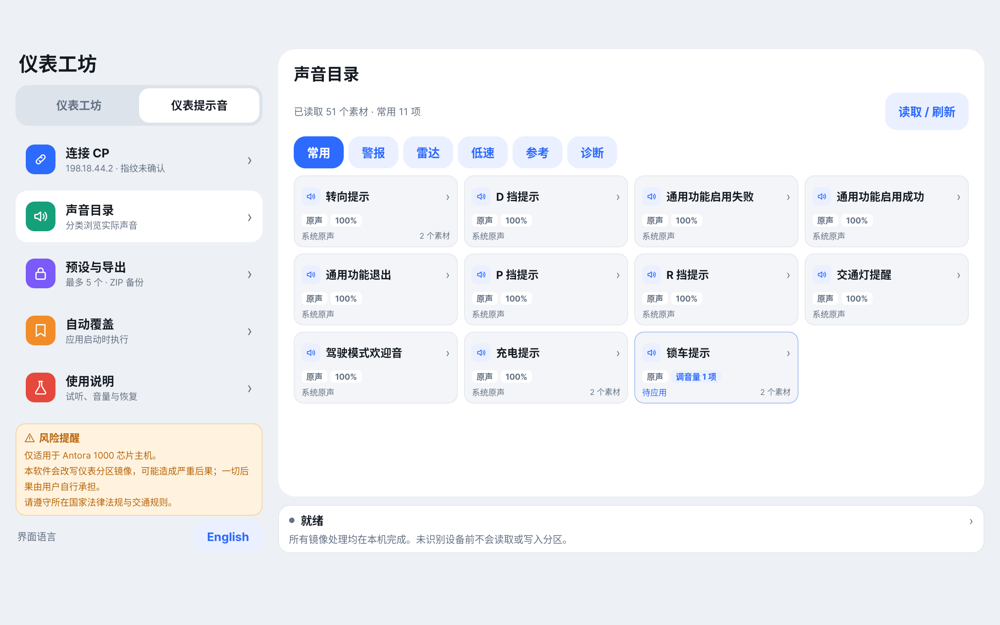
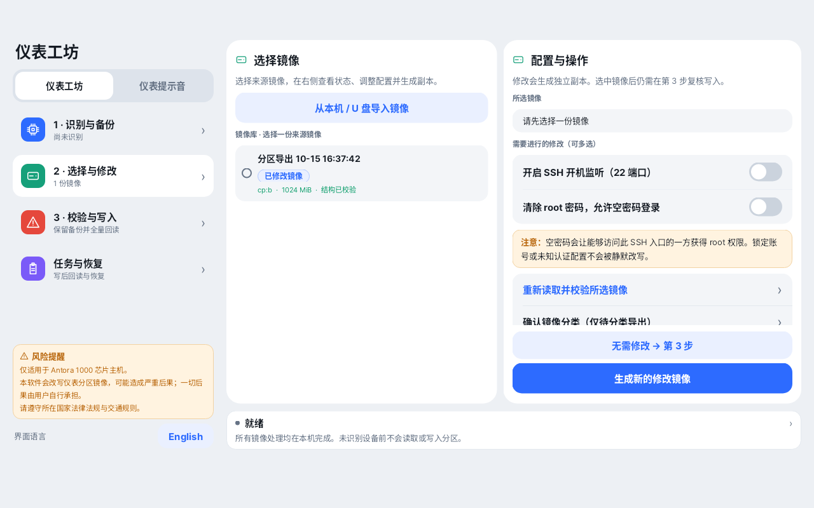
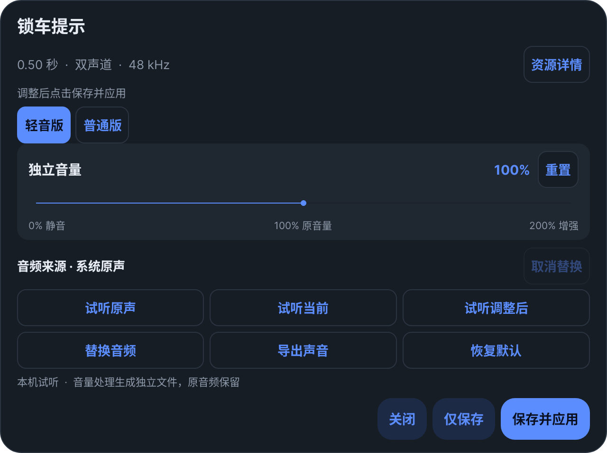

# EVDashboard · 仪表工坊

**English** | [简体中文](README.zh-CN.md)



An Android app for instrument CP image maintenance and instrument chime customization on head units with a **single Antora 1000 chip**. Back up and inspect images, create controlled modifications, and manage actual instrument sounds from one interface.

[Download](https://github.com/suyunkai/EVDashboard/releases/latest) · [Features](#features) · [Screenshots](#screenshots) · [Getting started](#getting-started) · [Disclaimer](#disclaimer) · [Build from source](#build-from-source)

> [!WARNING]
> **Only for head units with a single Antora 1000 chip.** The chipset alone does not establish compatibility; the firmware and partition layout must also pass the app's checks.
>
> **This software can rewrite instrument CP partition images.** An incompatible image, interrupted operation, power loss, or firmware issue can cause severe consequences, including an unusable instrument cluster or head unit and repairs at your expense. Replacing or muting chimes can also affect safety warnings.
>
> **You assume all risks and consequences of use.** Keep independent backups and a recovery plan. Perform operations only while parked, with stable power and no OTA update in progress. Follow the laws, regulations, and traffic rules in your country or region. Read the [disclaimer](#disclaimer) before use.

## Download

The current version is **[v0.2.3](https://github.com/suyunkai/EVDashboard/releases/tag/v0.2.3)**. Download the APK and its `.sha256` checksum from the release assets.

| Item | Details |
| --- | --- |
| Platform | Android 11 or later · `arm64-v8a` |
| Application ID | `com.kooo.evdashboard` |
| Signing | Public AOSP testkey; not a private production signing key |

> [!IMPORTANT]
> The public testkey does not provide an exclusive publisher identity. Verify the download source and checksum. Updating an existing installation requires the same signing certificate; uninstalling clears internal settings. See [signing details](signing/README.md) (Chinese).

## Features

| Area | What you can do |
| --- | --- |
| Image backup | Identify the current CP slot, export a complete image, verify its hash, and classify backups. |
| Image editing | Import a compatible image, independently configure SSH startup and root password clearing, and generate a new image while preserving the source. |
| Image writing | Review the candidate, write only the current CP rootfs slot, and verify the complete readback. |
| Instrument chimes | Read actual CP WAV resources; browse categorized, scrollable sound cards; open a card to preview, replace, restore, or export sounds. |
| Independent volume | Adjust original or replacement audio from **0% (mute) to 200%**. Derived files preserve the original and replacement sources. |
| Presets and sharing | Save up to **5 named presets**; import/export configuration and audio together as ZIP; export individual sounds. |
| Startup apply | Optionally reapply configured sound overlays once per app process launch, subject to identity and parked-state checks. Disabled by default. |
| Interface | Chinese/English switching, compact sound dialogs, preset cards, wide-screen image selection/configuration columns, and task timing/progress. |

Image-processing tools are bundled in the APK. Installed operation does not download image-processing components; sound management requires a local connection to the CP system.

## Screenshots

The screenshots below show the Chinese interface with example data. The app also supports English.

### Instrument sounds

Browse sound categories and see replacement and volume settings on compact cards.

[](docs/images/sound-catalog.png)

### Image workspace

Select an image in the middle column and review its configuration and actions on the right.

[](docs/images/image-workspace.png)

### Sound editor · Dark appearance

Adjust independent volume, preview audio, select a replacement, restore defaults, or export a sound from one dialog.

[](docs/images/sound-editor-dark.png)

## Getting started

1. **Check compatibility and prepare recovery.** Confirm a head unit with a **single Antora 1000 chip**, Android 11+, authorized root access, stable power, and sufficient free storage. Keep the app in the foreground and the vehicle parked; prevent sleep or OTA activity during operations.
2. **Install and grant permissions.** Download the APK from Releases, verify its checksum, install it, and grant the requested Android file-access permissions. Image operations require authorized UID 0 access; sound operations require an accessible CP SSH service and explicit host-identity confirmation.
3. **Create and preserve a backup.** In Workshop, follow **Identify & back up → Select & modify → Verify & write**. Copy a valid backup to separate storage before making persistent changes. An imported image passing inspection is not automatically safe to flash.
4. **Configure chimes deliberately.** Connect to CP, read the sound catalog, and open a sound card. Choose a replacement and/or adjust volume, then save locally or explicitly save and apply. Review every rule before enabling startup apply.

> [!NOTE]
> **Image writes are persistent. Sound changes use temporary resource overlays.** Sound overlays do not flash the rootfs and need reapplying after the CP runtime is reset. Importing a sound ZIP only updates local configuration; it does not immediately change CP audio.

## Working with sounds

- **Browse by category.** Common, alerts, radar, low-speed, reference, and diagnostic groups use fixed-size cards with vertical scrolling. Status badges show replacement and volume settings; operations live in the card dialog.
- **Keep sources intact.** Replacement selection and volume are separate settings. `100%` uses the selected source's level; `200%` is approximately +6 dB, with soft limiting. Every adjustment creates derived audio rather than accumulating changes in the source.
- **Edit related sounds together.** A card can contain several related resources. Switching between them preserves the dialog's drafts; closing discards unsaved edits. Saving commits the card's drafts together, and save-and-apply applies that card's changes.
- **Preview and export.** Listen to the original, replacement, or adjusted sound. Individual export offers the original, current CP sound, configured sound, and replacement source before gain adjustment, when available.
- **Switch presets.** Name and save up to five templates, then load locally or load and apply. ZIP exports include rules, volume values, source hashes, and referenced audio files.
- **Review shared resources.** One file may serve several events. Low-speed warning sounds can use shared tracks and speed-dependent mixing, so a single-file preview does not reproduce the vehicle's final output. Unconfirmed reference/diagnostic mappings are preview/export only.
- **Understand short previews.** Clips shorter than 0.5 seconds receive a 600 ms preview lead-in and repeat three times. This affects only the local preview cache; exported and applied audio retain their configured samples and level.

## Compatibility and operational limits

<details>
<summary><strong>Image compatibility and write safeguards</strong></summary>

- Image operations require UID 0 through authorized `su` or user-enabled, authorized local ADB at `127.0.0.1:5555`. The app does not automatically run `adb root`, restart adbd, or replace authorization.
- `/proc/boot_slot` must explicitly report `cp:a` or `cp:b`, mapped to `cp_rootfs_a` / `cp_rootfs_b`. Android A/B slots are not used to guess the CP slot.
- The supported container is a complete **1 GiB FIP with one rootfs payload**, EROFS offset/block size 4096, compatible features `1`, and incompatible features `0`.
- Only recognized Dropbear socket, preset, and account layouts are editable. Locked accounts, masked/overridden configurations, and unknown layouts are rejected.
- Writing requires a matching local backup baseline. File differences must be limited to the permitted SSH/password changes or their reversal. Do not flash across vehicles or firmware versions.
- Before writing, the app rechecks the slot, boot session, capacity, source/candidate hashes, mounts, and holders. It writes only the current CP rootfs, then compares the complete readback by hash and bytes and checks that the other slot and metadata are unchanged.
- There is no automatic reboot, slot switch, or failed-write retry. An interrupted task with an unknown result requires manual verification before further operations.
- Identical-content writes are refused by default. The optional identical-content rewrite test requires extra confirmation and provides no functional upgrade.

**Successful validation or readback does not guarantee bootability, recovery, or automatic A/B fallback.**

</details>

<details>
<summary><strong>Sound connection, formats, and startup apply</strong></summary>

- Sounds use root SSH, default `198.18.44.2:22`, with temporary bind mounts under `/run/instrument-workshop`. The IPv4 address is editable; the port remains 22. Changing the address clears host trust and disables startup apply until identity is confirmed again.
- SSH passwords remain in interface memory and are not persisted. Startup apply requires an empty-password connection. A changed host key requires fresh user confirmation; foreign overlays are neither removed nor treated as originals.
- Catalog reads and pre/post-apply checks fetch fresh SHA-256 manifests, reuse matching immutable local audio, and download only missing or changed resources. Hash checks and rollback handling remain in place.
- WAV handling supports chunk-aware PCM16 parsing and preserves original container metadata on original-sound export. Other imports use Android MediaCodec. Replacements are converted to the target's 48 kHz mono/stereo format, with a maximum duration of 30 seconds.
- Apply tasks use a CP-side batch lock and restart only affected playback services that were already running. On failure, they attempt to restore the previous overlay group and service state. An uncertain task is not automatically replayed after SSH disconnection.
- ZIP files contain `manifest.json` and `audio/<sha256>.wav`. Import validates paths, duplicates, size, version, hashes, format, and channels before replacing local rules. Apply checks the current CP original hashes again to reject incompatible presets.
- Startup apply is **off by default** and runs once per app process launch, not on every redraw or category switch. It requires a trusted CP identity/catalog and independent, read-only vehicle API confirmation of P gear and fresh zero speed. Missing or uncertain conditions cause it to skip and record the result. There is no Android boot-triggered replay.
- Muted rules are included when applying a configuration. Review them before enabling automatic application. Older directory-level sound overlays must be restored from the connection page before reading the new catalog.

</details>

<details>
<summary><strong>Storage, backups, and task progress</strong></summary>

The image library is in the **current Android user's** `Documents/EVDashboard/`:

```text
images/       Images and separate JSON records
work/         Generation intermediates, retained on failure
tasks/        Write manifests and logs
deleted-*/    Recoverable files after confirmed deletion
```

- Source images are never edited in place. Image generation needs approximately **4 GiB of additional free space**. Writing needs another **2.25 GiB** for root-owned staging/readback under `/data/local/evdashboard/jobs/<UUID>`. Successful write-task files are currently retained.
- The last valid original backup for the same device, CP slot, and firmware baseline cannot be deleted through the app. Original classification cannot be downgraded; deleting other originals requires two confirmations. Deletion moves files into recovery directories and does not immediately reclaim space.
- An “original” label records the user's source classification; it is not a manufacturer-authenticity certificate. External file tools, root access, or a factory reset can bypass in-app protection. Keep independent backups.
- The built-in picker supports local storage and already-mounted USB drives without requiring a separate file manager. It rejects same-name overwrites and writes into the protected image library. Image imports accept `.img` / `.bin` and undergo structural inspection.
- Backup export uses a root read-only stream, app-owned output, and synchronized writes. Partition hashes before/after export must match the complete output hash. Multi-user path fallbacks verify the actual current user and matching file hashes.
- Task cards show the current operation and elapsed time. Measurable steps show actual step progress and a supported time estimate; other steps use an activity indicator and elapsed time. A completed copy is not a successful task until all checks finish.

</details>

## Disclaimer

This is an independent project for technical research and evaluation by users with appropriate authorization. No manufacturer approval, endorsement, or vehicle safety certification is claimed.

The software, source code, binaries, and documentation are provided **“AS IS” and “AS AVAILABLE,” without warranties** of safety, compatibility, reliability, accuracy, fitness for a particular purpose, or uninterrupted operation. Checks, backups, and recovery features reduce some risks; they do not eliminate them or guarantee restoration.

You are responsible for confirming permission to modify the device, assessing compatibility, preserving backups, arranging recovery, reviewing sound settings, and complying with applicable laws, regulations, and traffic rules. Do not operate the software while driving or use configurations that compromise required safety warnings.

**You bear the risks and consequences of your use and modifications.** To the extent permitted by applicable law, the developers and contributors accept no liability for losses arising from use, including data loss, device damage, vehicle malfunction, accidents, or repair costs. Nothing in this notice excludes liabilities or rights that cannot be excluded under applicable law.

## Build from source

Use **JDK 17+**, **Android SDK 36**, and **NDK 28.2.13676358**. Native build scripts currently target a macOS host (`darwin-x86_64` NDK toolchain); other hosts require adapting the toolchain path. Set `ANDROID_NDK_HOME` if the NDK is installed elsewhere. The first build needs access to Gradle/Maven dependencies.

```sh
# Local unit tests, lint, and debug APKs
./gradlew :app:testDebugUnitTest :app:lintDebug :app:assembleDebug :app:assembleDebugAndroidTest

# Release APK and instrumentation APK using the public AOSP testkey
./gradlew -PinstrumentBuildType=release :app:assembleRelease :app:assembleReleaseAndroidTest
```

Outputs: `app/build/outputs/apk/debug/app-debug.apk` and `app/build/outputs/apk/release/app-release.apk`. Building does not install the app or connect to a vehicle.

Native sources and build inputs are in `native/` and `vendor/`. Use an explicit device serial, the actual Android user, and a deliberately selected test class for instrumentation; device tests must not be run indiscriminately on a vehicle.

Third-party source and license information is in [THIRD_PARTY.md](THIRD_PARTY.md) (Chinese); license texts are also included in APK assets. When redistributing bundled tools, comply with their respective source and license obligations.
